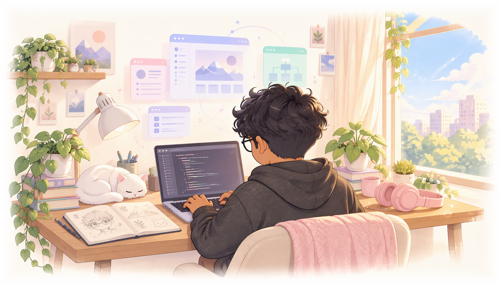

  <picture>
    <source media="(prefers-color-scheme: dark)" type="image/webp" srcset="https://raw.githubusercontent.com/abhinavtie2008/abhinavtie2008/main/assets/banner.webp">
    <source media="(prefers-color-scheme: light)" type="image/webp" srcset="https://raw.githubusercontent.com/abhinavtie2008/abhinavtie2008/main/assets/banner-light.webp">
    
  </picture>

<h1 align="center">Abhinav Sharma</h1>

  <picture>
    <source media="(prefers-color-scheme: dark)" srcset="https://readme-typing-svg.demolab.com?font=JetBrains+Mono&weight=600&size=26&duration=3000&pause=800&color=F9A8D4&center=true&vCenter=true&width=850&lines=Full-stack+developer;B.Tech+student+in+Delhi;Building+cute+things+that+work">
    
  </picture>

  I'm Abhinav — a full-stack developer and B.Tech student in Delhi. I turn rough sketches into working products, and I like interfaces that feel a little more human.

  
  
  

  <picture>
    <source media="(prefers-color-scheme: dark)" type="image/svg+xml" srcset="https://raw.githubusercontent.com/abhinavtie2008/abhinavtie2008/main/assets/divider.svg">
    
  </picture>

## <picture><source media="(prefers-color-scheme: dark)" type="image/svg+xml" srcset="https://raw.githubusercontent.com/abhinavtie2008/abhinavtie2008/main/assets/star.svg"></picture> About me

I'm a B.Tech student in Delhi and a full-stack developer. I enjoy the whole arc of a build: sketch it, design it, code it, polish it.

- **Studying:** B.Tech in Delhi, India
- **Building with:** HTML, CSS, JavaScript, Python, React.js, Node.js, Bootstrap, and Tailwind
- **Drawn to:** interface design, full-stack architecture, and problems that need a second look

## <picture><source media="(prefers-color-scheme: dark)" type="image/svg+xml" srcset="https://raw.githubusercontent.com/abhinavtie2008/abhinavtie2008/main/assets/star.svg"></picture> Tech stack

  <picture>
    <source media="(prefers-color-scheme: dark)" srcset="https://skillicons.dev/icons?i=html,css,js,python,react,nodejs,bootstrap,tailwind&theme=dark&perline=8">
    
  </picture>

## <picture><source media="(prefers-color-scheme: dark)" type="image/svg+xml" srcset="https://raw.githubusercontent.com/abhinavtie2008/abhinavtie2008/main/assets/star.svg"></picture> Selected work

A couple of things I've had fun building.

<table>
  <tr>
    <td width="50%" valign="top">
      <h3>AirSign</h3>
      
Gesture control for the browser — point, pinch, drag, and scroll with your hand. Live on the Microsoft Edge Add-ons store.

      

        <a href="https://github.com/abhinavtie2008/AirSign">Source</a> ·
        <a href="https://abhinavtie2008.github.io/AirSign/">Demo</a> ·
        <a href="https://microsoftedge.microsoft.com/addons/detail/airsign-%E2%80%94-touchless-brows/efeefgmnlcddffpkhlidnopmfjbndehe">Edge Add-ons</a>
      

    </td>
    <td width="50%" valign="top">
      <h3>webvision</h3>
      
An independent, unofficial concept redesign of the Sarathi Parivahan driving-licence portal — a full-stack exercise in making a dense government form easier to move through.

      

        <a href="https://github.com/abhinavtie2008/webvision">Source</a> ·
        <a href="https://abhinavtie2008.github.io/webvision/">Demo</a>
      

    </td>
  </tr>
</table>

## <picture><source media="(prefers-color-scheme: dark)" type="image/svg+xml" srcset="https://raw.githubusercontent.com/abhinavtie2008/abhinavtie2008/main/assets/star.svg"></picture> On GitHub

<table>
  <tr>
    <td width="50%" align="center">
      <picture>
        <source media="(prefers-color-scheme: dark)" srcset="https://github-profile-summary-cards.vercel.app/api/cards/stats?username=abhinavtie2008&bg_color=141321&title_color=F472B6&text_color=FDF2F8&icon_color=F9A8D4&border_color=3B2A4A&stroke_color=3B2A4A">
        
      </picture>
    </td>
    <td width="50%" align="center">
      <picture>
        <source media="(prefers-color-scheme: dark)" srcset="https://github-profile-summary-cards.vercel.app/api/cards/most-commit-language?username=abhinavtie2008&bg_color=141321&title_color=F472B6&text_color=FDF2F8&icon_color=F9A8D4&border_color=3B2A4A&stroke_color=3B2A4A">
        
      </picture>
    </td>
  </tr>
</table>

  <picture>
    <source media="(prefers-color-scheme: dark)" srcset="https://streak-stats.demolab.com?user=abhinavtie2008&hide_border=true&background=141321&border=1E293B&stroke=1E293B&ring=F472B6&fire=F9A8D4&currStreakNum=FDF2F8&sideNums=FDF2F8&currStreakLabel=F9A8D4&sideLabels=C4B5FD&dates=64748B">
    
  </picture>

## <picture><source media="(prefers-color-scheme: dark)" type="image/svg+xml" srcset="https://raw.githubusercontent.com/abhinavtie2008/abhinavtie2008/main/assets/star.svg"></picture> Beyond the code

When I'm not at the keyboard:

- **Chess** — I like positions with no obvious move; it's the same patience debugging asks for.
- **Sketching and design** — most interfaces start on paper for me, as rough layouts and wireframes.
- **Music** — my default focus soundtrack.
- **Hard problems** — the reason I chose engineering; I'd rather untangle something tricky than repeat something solved.

<b>What I'm looking for</b>

 

A full-stack team where I can own features end to end — from the first sketch to the shipped interface, in a place where design and engineering sit close together.

<b>Ask me about</b>

 

Chess middlegames, small UI details, or the last thing I sketched.

## <picture><source media="(prefers-color-scheme: dark)" type="image/svg+xml" srcset="https://raw.githubusercontent.com/abhinavtie2008/abhinavtie2008/main/assets/star.svg"></picture> Contact

  The fastest way to reach me is <a href="https://www.linkedin.com/in/abhinav-sharma-126b1a43a/">LinkedIn</a> or <a href="mailto:abhinav.tie.2008@gmail.com">email</a>. I'm open to full-stack developer opportunities.

<i>Powered by sketches, chess games, and a steady playlist.</i>

  <picture>
    <source media="(prefers-color-scheme: dark)" type="image/svg+xml" srcset="https://raw.githubusercontent.com/abhinavtie2008/abhinavtie2008/main/assets/divider.svg">
    
  </picture>

